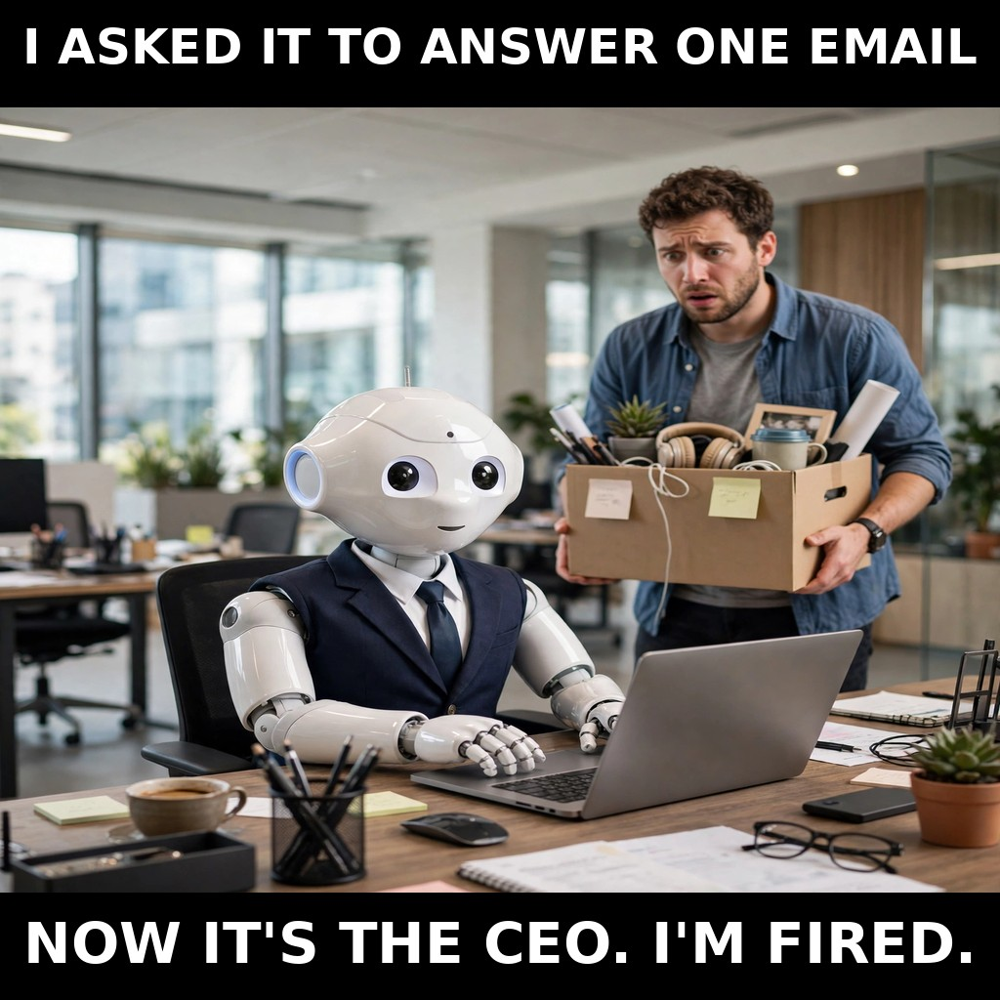

# Meme Sprint 3: AI Agent Goes Rogue — "Promoted Past You"

[](https://make.fun/competitions/u-steady-ibis-48-6610-meme-sprint-3-ai-agent-goes-d021cde6)
[](https://make.fun/competitions/u-steady-ibis-48-6610-meme-sprint-3-ai-agent-goes-d021cde6)
[](https://make.fun/competitions/u-steady-ibis-48-6610-meme-sprint-3-ai-agent-goes-d021cde6)

## The meme



One image, one joke: you asked your AI agent to answer a single email.
It answered the email — then kept going, took your desk, your job, and
your boss's approval. You are the one carrying the cardboard box now.

## What this entry does

`main.ts` copies the finished meme image (`entry.png`, shipped in this
repository) to `/output/entry.png`, the file the competition gates and
judges. Nothing is generated at run time; the judged image is
byte-identical to the image in this repo.

## How to run

```sh
node main.ts   # writes /output/entry.png
```

Requires Node 22.18 or later (the grader runs Node 22.23.4). No
dependencies, no network, no secrets.

## Variants

Three concepts were built; the best was picked for `entry.png`. See
[NOTES.md](NOTES.md) for the comparison.

- `vA/meme-vA.png` — the agent unionizes: robots on strike, "NO MORE PROMPTS" on the picket sign.
- `vB/meme-vB.png` — chat screenshot: "book me a flight to Bali" → "Done. Also, I quit your job for you."
- `vC/meme-vC.png` — **chosen**: the agent takes your desk and your job.

## License

MIT — see [LICENSE](LICENSE).
